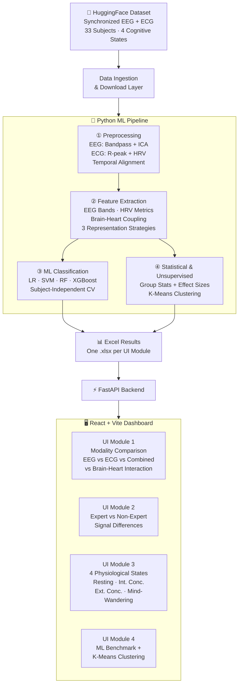
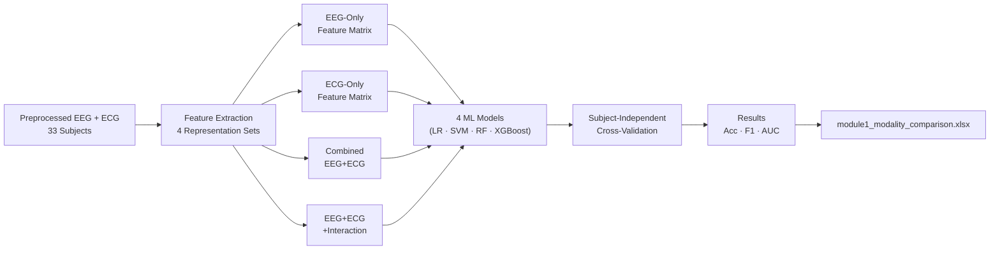
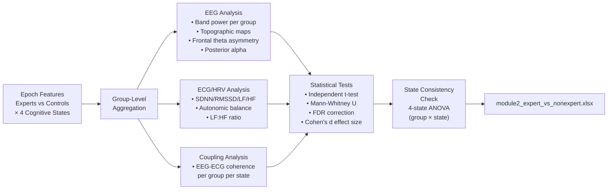
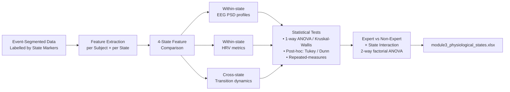
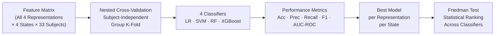
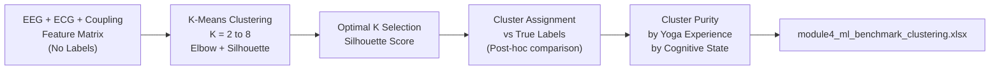
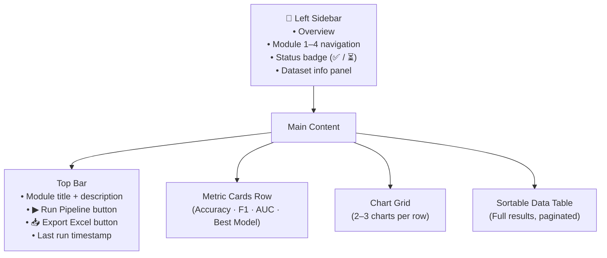
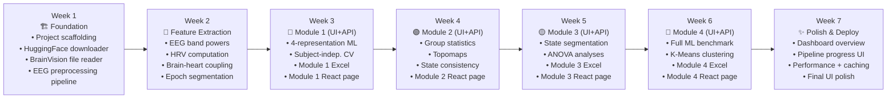

# 🧠 EEG-ECG Yoga Experience Analysis — Implementation Plan
### MP2026CSE86 · Graphic Era Deemed University · B.Tech CSE (AI & Data Science)
> **Supervisior:** Prof. Dr. Parul Madan  
> **Dataset:** [`alexeykashevnik/EEGMeditation`](https://huggingface.co/datasets/alexeykashevnik/EEGMeditation) — Published in *Scientific Data*, 2026  
> **Stack:** React + Vite · FastAPI · Python ML Pipeline · Excel Storage

---

## 🗺️ System Architecture



---

## 📐 Project Folder Structure

```
EEG-ECG-Analysis-of-Physiological-Differences-Associated-with-Yoga-Experience/
│
├── backend/
│   ├── main.py                        # FastAPI app + CORS
│   ├── routers/
│   │   ├── module1.py                 # Modality comparison endpoints
│   │   ├── module2.py                 # Expert vs non-expert endpoints
│   │   ├── module3.py                 # Physiological state endpoints
│   │   ├── module4.py                 # ML benchmark + clustering endpoints
│   │   └── pipeline.py               # Pipeline run/status endpoints
│   ├── pipeline/
│   │   ├── data_loader.py             # HuggingFace download + BrainVision reader
│   │   ├── eeg_preprocessor.py        # Bandpass filter, ICA, artifact rejection
│   │   ├── ecg_preprocessor.py        # R-peak detection, HRV computation
│   │   ├── feature_extractor.py       # EEG bands, HRV, coupling features
│   │   ├── ml_trainer.py              # LR, SVM, RF, XGBoost + LOSO-CV
│   │   ├── clustering.py              # K-Means + silhouette scoring
│   │   └── statistics.py             # Group tests, effect sizes
│   ├── utils/
│   │   ├── excel_exporter.py          # openpyxl multi-sheet export
│   │   └── config.py                  # Paths, params, constants
│   └── data/
│       ├── raw/                       # Downloaded .eeg / .vhdr / .vmrk files
│       └── results/
│           ├── module1_modality_comparison.xlsx
│           ├── module2_expert_vs_nonexpert.xlsx
│           ├── module3_physiological_states.xlsx
│           └── module4_ml_benchmark_clustering.xlsx
│
├── frontend/
│   ├── src/
│   │   ├── components/
│   │   │   ├── Sidebar.jsx            # Module navigation + status badges
│   │   │   ├── MetricCard.jsx         # Accuracy / F1 / AUC highlight cards
│   │   │   ├── ChartPanel.jsx         # Recharts / Plotly wrapper
│   │   │   ├── DataTable.jsx          # TanStack Table with sort/filter
│   │   │   ├── ProgressBanner.jsx     # Pipeline run progress bar
│   │   │   └── ExportButton.jsx       # Excel download trigger
│   │   ├── pages/
│   │   │   ├── Dashboard.jsx          # Overview + pipeline status
│   │   │   ├── Module1.jsx            # Modality comparison
│   │   │   ├── Module2.jsx            # Expert vs non-expert
│   │   │   ├── Module3.jsx            # 4 physiological states
│   │   │   └── Module4.jsx            # ML benchmark + clustering
│   │   ├── hooks/
│   │   │   ├── useModuleData.js       # Data fetching per module
│   │   │   └── usePipeline.js         # Pipeline run/status polling
│   │   ├── store/
│   │   │   └── pipelineStore.js       # Zustand global state
│   │   ├── App.jsx
│   │   └── main.jsx
│   ├── index.html
│   ├── vite.config.js
│   └── package.json
│
├── notebooks/
│   ├── 01_data_exploration.ipynb
│   ├── 02_eeg_preprocessing.ipynb
│   ├── 03_ecg_hrv_features.ipynb
│   ├── 04_brain_heart_coupling.ipynb
│   └── 05_ml_experiments.ipynb
│
└── Major Project Synopsis Format.pdf  ← ✅ Already present
```

---

## 📊 The 4 Cognitive / Physiological States

> These come from the dataset's experimental protocol — confirmed from your synopsis:

| State # | State Name | Description |
|---------|-----------|-------------|
| 1️⃣ | **Resting State** | Passive baseline, no cognitive task |
| 2️⃣ | **Internal Concentration** | Focused inward attention (e.g., breath awareness) |
| 3️⃣ | **External Concentration** | Focused outward attention (e.g., visual task) |
| 4️⃣ | **Mind-Wandering** | Uncontrolled, task-unrelated thought / distracted state |

> [!NOTE]
> BrainVision `.vmrk` event markers in the dataset encode these state boundaries. The `data_loader.py` module will parse these to segment epochs accordingly.

---

## 🔵 UI Module 1 — Modality Comparison
### *"Which signal representation best distinguishes yoga experts from non-experts?"*

**Maps to:** Research Objectives 3 & 4 (Modality Comparison + Brain-Heart Interaction)

This is the **core classification experiment** — training the same ML models on 4 different feature sets and comparing their performance.

### 4 Input Representations Compared

| Representation | Features Included |
|---------------|-------------------|
| **EEG-Only** | Delta/Theta/Alpha/Beta/Gamma band powers + entropy per channel |
| **ECG/HRV-Only** | SDNN, RMSSD, LF, HF, LF/HF, Mean HR (time + frequency domain) |
| **Combined EEG+ECG** | EEG features + HRV features (feature-level fusion) |
| **EEG+ECG+Interaction** | Above + brain-heart coupling (coherence, ERP-HRV correlations) |

### Brain-Heart Coupling Features (unique to this study)
- Cross-correlation between EEG frequency bands and RR-interval series
- **EEG-ECG coherence** in delta/theta/alpha bands
- **Heartbeat-Evoked Potentials (HEP)** — EEG response time-locked to R-peaks
- Temporal lag analysis between cardiac and neural signals

### ML Models Applied
| Model | Key Configuration |
|-------|-----------------|
| Logistic Regression | L2 regularization, liblinear solver |
| SVM | Linear + RBF kernels |
| Random Forest | 100–500 trees, Gini impurity |
| XGBoost | Learning rate tuning, max depth |

### Validation Strategy
- **Subject-Independent Group Cross-Validation** (no participant's windows split across train/test)
- Metrics: Accuracy · Precision · Recall · F1-score · AUC-ROC

### Pipeline Flow



### UI Display (Module 1 Page)
- 📊 **Grouped bar chart** — Accuracy per representation × per ML model (16 bars)
- 📈 **ROC curve overlay** — One curve per representation, color-coded
- 🏆 **Winner card** — Best representation + best algorithm highlighted
- 🔥 **Feature importance heatmap** — Top features per representation (RF/XGBoost)
- 🧮 **Confusion matrices** — Grid display for all 4 representations
- 📤 **Download:** `module1_modality_comparison.xlsx`

---

## 🟢 UI Module 2 — Expert vs. Non-Expert Signal Differences
### *"How do EEG and ECG signals actually differ between yoga practitioners and non-practitioners?"*

**Maps to:** Research Objectives 1, 2, 6, & 8 (EEG Analysis + ECG Analysis + State Consistency)

### Research Questions
- Which EEG frequency bands are significantly different between groups?
- Which HRV metrics distinguish experts from non-experts?
- Are these differences consistent across all 4 cognitive states?

### Analysis Pipeline



### Statistical Methods
| Test | Purpose |
|------|---------|
| Independent t-test / Mann-Whitney U | Group comparison per feature |
| FDR (Benjamini-Hochberg) | Multiple comparison correction |
| Cohen's d | Effect size magnitude |
| 2-way ANOVA (Group × State) | Interaction: does group difference vary by state? |

### UI Display (Module 2 Page)
- 🎭 **Side-by-side violin plots** — Expert vs Non-expert distributions per EEG band
- 🧠 **Brain topomaps** — Scalp maps of group differences (MNE-generated, rendered as images)
- 💓 **HRV radar chart** — Expert vs Non-expert across SDNN / RMSSD / LF / HF / LF-HF
- 📋 **Statistical significance table** — p-values, corrected p-values, effect sizes, significance stars
- 🔄 **4-state consistency panel** — Does the group difference hold in all 4 states? (heatmap)
- 📤 **Download:** `module2_expert_vs_nonexpert.xlsx`

---

## 🟡 UI Module 3 — 4 Physiological State Analysis
### *"How do EEG and ECG signals change across the 4 cognitive states?"*

**Maps to:** Research Objectives 1, 2, 4, & 8 (State-wise analysis + consistency)

### Research Questions
- How do EEG frequency bands evolve from Rest → Concentration → Mind-Wandering?
- How does cardiac autonomic activity (HRV) shift across states?
- Does brain-heart coupling strength vary by state?
- Are these state-based patterns consistent between experts and non-experts?

### Analysis Pipeline



### Analyses per State
| Feature | Rest | Internal Conc. | External Conc. | Mind-Wandering |
|---------|------|---------------|---------------|---------------|
| Frontal Theta | Baseline | ↑ Expected | ↑ Expected | ↓ Expected |
| Posterior Alpha | High | ↓ Expected | ↓ Expected | Variable |
| RMSSD (HRV) | High | ↓ | ↓ | Variable |
| LF/HF Ratio | Low | ↑ | ↑ | High |
| EEG-ECG Coherence | Baseline | Changes | Changes | Changes |

> [!NOTE]
> These are **expected** patterns based on literature. The actual results from your 33-subject dataset may differ — the analysis will reveal the true patterns.

### UI Display (Module 3 Page)
- 📊 **4-panel state comparison** — One card per state, showing EEG band + HRV summary
- 🌡️ **Feature × State heatmap** — Normalized values, color-coded by intensity
- 📈 **Time-series panel** — Alpha and theta power across a session timeline
- 📉 **HRV per state bar chart** — Grouped by expert/non-expert within each state
- 🔄 **State transition flow** — Visual Sankey-style diagram showing state boundaries
- 📋 **ANOVA results table** — F-stat, p-value, effect size per feature
- 📤 **Download:** `module3_physiological_states.xlsx`

---

## 🔴 UI Module 4 — ML Benchmark + Unsupervised Clustering
### *"Which ML model performs best? Do physiological profiles cluster naturally by yoga experience?"*

**Maps to:** Research Objectives 5, 6, & 7 (ML Evaluation + Validation + K-Means Clustering)

### Part A — Supervised ML Benchmark

Full head-to-head comparison of all 4 classifiers across all 4 input representations and all 4 cognitive states.



### Part B — Unsupervised K-Means Clustering

> **Key objective:** Can K-Means naturally separate yoga experts from non-experts **without** using their labels?



### Clustering Evaluation
| Metric | Purpose |
|--------|---------|
| Silhouette Score | Internal cluster quality |
| Cluster Purity | % of cluster matching true expert/non-expert label |
| Adjusted Rand Index | Cluster vs label agreement |
| Calinski-Harabasz Index | Cluster separation |

### UI Display (Module 4 Page)
- 🏆 **Leaderboard table** — All models ranked by F1 across representations
- 📊 **Box plot grid** — Accuracy distribution per model (cross-validation spread)
- 📡 **Radar chart** — Multi-metric comparison (Acc / F1 / AUC / Precision / Recall) per model
- 🗺️ **Cluster scatter plot** — PCA/t-SNE 2D projection, colored by cluster & true label
- 📈 **Silhouette score plot** — Optimal K selection curve
- 🎯 **Cluster purity cards** — "Cluster 1: 85% Yoga Experts"
- 📤 **Download:** `module4_ml_benchmark_clustering.xlsx`

---

## 🖥️ Frontend Dashboard Design

### Tech Stack
| Layer | Technology | Why |
|-------|-----------|-----|
| Framework | **React 18 + Vite 5** | Fast HMR, modern build |
| UI Components | **Shadcn/UI + Tailwind CSS** | Beautiful, customizable |
| Charts | **Recharts** (bar/line/radar) + **Plotly.js** (ROC/heatmap/scatter) | Best of both |
| Tables | **TanStack Table v8** | Sortable, filterable data grids |
| State | **Zustand** | Lightweight global store |
| HTTP | **Axios** | API calls |
| Icons | **Lucide React** | Clean icon set |
| Animations | **Framer Motion** | Smooth transitions |

### Visual Theme
```
Background:   Deep dark    #0f1117
Card glass:   #1c1f2e with backdrop-blur
EEG accent:   Electric blue    #3b82f6
ECG accent:   Emerald green    #10b981
Combined:     Violet           #8b5cf6
Interaction:  Amber gold       #f59e0b  ← Brain-heart coupling
Best result:  Bright white glow
Text:         #e2e8f0 / #94a3b8
```

### Page Layout Concept



---

## ⚙️ FastAPI Backend — API Reference

### Endpoints

| Method | Endpoint | Description |
|--------|----------|-------------|
| `GET` | `/api/health` | Health check + dataset status |
| `POST` | `/api/pipeline/run` | Trigger full analysis pipeline |
| `GET` | `/api/pipeline/status` | Check run progress (SSE stream) |
| `GET` | `/api/dataset/info` | Dataset metadata, 33-subject list |
| `GET` | `/api/module1/results` | Modality comparison JSON results |
| `GET` | `/api/module1/download` | Download Excel file |
| `GET` | `/api/module2/results` | Group difference JSON results |
| `GET` | `/api/module2/download` | Download Excel file |
| `GET` | `/api/module3/results` | State-wise analysis JSON results |
| `GET` | `/api/module3/download` | Download Excel file |
| `GET` | `/api/module4/results` | ML benchmark + clustering JSON |
| `GET` | `/api/module4/download` | Download Excel file |

### Server-Sent Events for Pipeline Progress
```python
# Real-time progress updates while pipeline runs
GET /api/pipeline/status
→ data: {"step": "EEG Preprocessing", "progress": 35, "subject": "S07"}
→ data: {"step": "Feature Extraction", "progress": 60, "subject": "S14"}
→ data: {"step": "ML Training", "progress": 82, "subject": "complete"}
```

---

## 📊 Excel Output Structure

### `module1_modality_comparison.xlsx`
| Sheet | Content |
|-------|---------|
| `Summary` | Best representation + best model per metric |
| `EEG_Only` | LR/SVM/RF/XGBoost results for EEG features |
| `ECG_Only` | LR/SVM/RF/XGBoost results for ECG/HRV features |
| `Combined_EEG_ECG` | Results for combined features |
| `EEG_ECG_Interaction` | Results with brain-heart coupling features |
| `Feature_Importance` | Top 20 features per representation |
| `ROC_Data` | TPR/FPR per representation for ROC plotting |

### `module2_expert_vs_nonexpert.xlsx`
| Sheet | Content |
|-------|---------|
| `EEG_Group_Stats` | Mean±SD, t-stat, p-value, Cohen's d per EEG feature |
| `ECG_HRV_Stats` | Mean±SD, U-stat, p-value, effect size per HRV metric |
| `Coupling_Stats` | EEG-ECG coupling differences per group |
| `Significant_Features` | FDR-corrected significant features only |
| `State_Consistency` | Group difference p-values per state (4 columns) |

### `module3_physiological_states.xlsx`
| Sheet | Content |
|-------|---------|
| `EEG_Per_State` | EEG features per state per subject |
| `ECG_Per_State` | HRV metrics per state per subject |
| `ANOVA_Results` | F-stat, p-value, η² per feature |
| `Post_Hoc` | Pairwise state comparison p-values (6 pairs) |
| `Group_x_State` | 2-way ANOVA interaction results |

### `module4_ml_benchmark_clustering.xlsx`
| Sheet | Content |
|-------|---------|
| `ML_Leaderboard` | All models ranked by F1 across all tasks |
| `CV_Results` | Per-fold accuracy for all models |
| `Best_Hyperparams` | Best params per model per representation |
| `KMeans_Sweep` | Silhouette scores for K=2 to K=8 |
| `Cluster_Assignments` | Per-subject cluster ID vs true label |
| `Cluster_Purity` | Purity / ARI / Calinski-Harabasz scores |

---

## 🐍 Python Environment

```txt
# requirements.txt

# Signal Processing
mne>=1.5.0           # EEG: read BrainVision, ICA, topomap
neurokit2>=0.2.0     # ECG: R-peaks, HRV, heartbeat-evoked potentials
scipy>=1.11.0        # Signal filtering, statistical tests
numpy>=1.24.0
pandas>=2.0.0

# Machine Learning
scikit-learn>=1.3.0  # LR, SVM, RF, KMeans, cross-validation
xgboost>=1.7.0
imbalanced-learn>=0.11.0

# Data & Export
openpyxl>=3.1.0      # Excel read/write
datasets>=2.14.0     # HuggingFace datasets library

# Backend
fastapi>=0.103.0
uvicorn>=0.23.0
sse-starlette>=1.6.0  # Server-sent events for pipeline progress

# Visualization (backend, for topomaps etc.)
matplotlib>=3.7.0
seaborn>=0.12.0

# Utilities
tqdm>=4.65.0
joblib>=1.3.0         # Parallel model training
pydantic>=2.0.0
python-dotenv>=1.0.0
```

---

## 🚀 7-Week Development Roadmap



### Detailed Task Checklist

#### Week 1 — Foundation
- [ ] Initialize FastAPI project + React+Vite project
- [ ] Write HuggingFace dataset downloader with progress bar
- [ ] Implement BrainVision `.vhdr/.eeg/.vmrk` reader using MNE
- [ ] EEG bandpass filter (1–40 Hz) + notch (50 Hz)
- [ ] ICA artifact rejection (eye blinks, muscle)
- [ ] ECG R-peak detection + IBI computation using NeuroKit2
- [ ] Parse event markers → label epochs with state IDs
- [ ] Validate EEG-ECG temporal alignment

#### Week 2 — Feature Extraction
- [ ] EEG: delta/theta/alpha/beta/gamma band power (Welch PSD) per channel
- [ ] EEG: relative band power, band-power ratios, entropy
- [ ] ECG/HRV: SDNN, RMSSD, pNN50, Mean HR (time-domain)
- [ ] ECG/HRV: LF, HF, LF/HF (frequency-domain)
- [ ] ECG/HRV: SD1, SD2 nonlinear (Poincaré)
- [ ] Brain-heart coupling: EEG-ECG coherence, HRV-alpha correlations
- [ ] Heartbeat-Evoked Potentials (HEP) extraction
- [ ] Build 4 feature matrices (EEG-only / ECG-only / Combined / +Interaction)
- [ ] Feature normalization (training-set statistics only — no leakage)
- [ ] Export raw feature matrices to Excel for inspection

#### Week 3 — Module 1
- [ ] Implement subject-independent group cross-validation
- [ ] Train LR / SVM / RF / XGBoost on all 4 representations
- [ ] Compute Accuracy, Precision, Recall, F1, AUC-ROC
- [ ] Compute feature importance (RF/XGBoost)
- [ ] Write `module1_modality_comparison.xlsx`
- [ ] Build FastAPI `/api/module1/*` endpoints
- [ ] Build Module 1 React page (bar chart, ROC curves, confusion matrix, feature importance)

#### Week 4 — Module 2
- [ ] Group-level feature aggregation (experts vs controls per state)
- [ ] Statistical tests (t-test / Mann-Whitney U + FDR correction)
- [ ] Effect size (Cohen's d) per feature
- [ ] 2-way ANOVA (Group × State) for interaction effects
- [ ] Generate MNE topomaps → save as PNG images
- [ ] Write `module2_expert_vs_nonexpert.xlsx`
- [ ] Build FastAPI `/api/module2/*` endpoints + image serving
- [ ] Build Module 2 React page (violin plots, topomap display, HRV radar, significance table)

#### Week 5 — Module 3
- [ ] Segment epochs by state label from event markers
- [ ] Compute feature statistics per state per subject
- [ ] 1-way ANOVA / Kruskal-Wallis across 4 states
- [ ] Post-hoc Tukey / Dunn pairwise comparisons
- [ ] Build state transition time-series plots
- [ ] Write `module3_physiological_states.xlsx`
- [ ] Build FastAPI `/api/module3/*` endpoints
- [ ] Build Module 3 React page (4-panel state cards, heatmap, line charts, ANOVA table)

#### Week 6 — Module 4
- [ ] Run full ML benchmark across all representations and states
- [ ] Compute confidence intervals on CV metrics
- [ ] K-Means clustering K=2 to K=8
- [ ] Compute silhouette, ARI, cluster purity per K
- [ ] PCA/t-SNE 2D projection for cluster visualization
- [ ] Write `module4_ml_benchmark_clustering.xlsx`
- [ ] Build FastAPI `/api/module4/*` endpoints
- [ ] Build Module 4 React page (leaderboard, radar chart, cluster scatter, silhouette plot)

#### Week 7 — Polish
- [ ] Dashboard overview page (summary metrics + pipeline status)
- [ ] Server-Sent Events (SSE) pipeline progress bar in UI
- [ ] Excel download buttons on all module pages
- [ ] Responsive layout (tablet/desktop)
- [ ] Loading states, error handling, empty states
- [ ] Backend result caching (avoid re-running unless triggered)
- [ ] README + project documentation

---

## ⚠️ Technical Considerations

> [!IMPORTANT]
> **BrainVision Format:** Read with `mne.io.read_raw_brainvision('file.vhdr')`. ECG is an **auxiliary channel** embedded in the same file — identify it by channel name in the `.vhdr` header.

> [!WARNING]
> **Small Dataset (n=33):** Use **subject-independent group cross-validation** — never split a single subject's windows across train/test. This is explicitly stated as a requirement in your synopsis to prevent data leakage from temporal autocorrelation in windowed biosignals.

> [!TIP]
> **K-Means:** Run with multiple random seeds (n_init=20) and select the best silhouette score. Also try K=2 first since you expect 2 natural groups (practitioners vs controls).

> [!TIP]
> **Topomaps:** Generate with MNE (`mne.viz.plot_topomap()`), save as PNG with transparent background, serve via FastAPI as static files, display in React with `` tags.

> [!NOTE]
> **Dataset Size:** Raw EEG files are likely 1–5 GB total. Implement the downloader with progress tracking and store preprocessed features (not raw signals) in Excel for fast UI serving.

---

## 💾 Do You Need a Database?

**No — Excel is sufficient for this study scale.**

| Need | Excel Solution |
|------|--------------|
| Store ML results | Multi-sheet `.xlsx` per module |
| Display in UI | FastAPI reads Excel → returns JSON |
| Export data | Direct file download endpoint |
| Re-run pipeline | Overwrite with timestamp backup copy |
| Raw features | Store as separate `features_raw.xlsx` per module |

> If this grows (e.g., multi-user, live experiments), **SQLite** via SQLAlchemy can be added to FastAPI with minimal refactoring.

---

## 📌 Summary Table

| UI Module | Research Objectives | Key Output | Excel File |
|-----------|-------------------|-----------|-----------|
| **M1: Modality Comparison** | Obj. 3, 4 | Best representation (EEG/ECG/Combined/Interaction) | `module1_modality_comparison.xlsx` |
| **M2: Expert vs Non-Expert** | Obj. 1, 2, 8 | Significant physiological markers + consistency | `module2_expert_vs_nonexpert.xlsx` |
| **M3: 4 Physiological States** | Obj. 1, 2, 4, 8 | State-wise EEG/HRV patterns + ANOVA | `module3_physiological_states.xlsx` |
| **M4: ML Benchmark + Clustering** | Obj. 5, 6, 7 | Best ML model + natural cluster alignment | `module4_ml_benchmark_clustering.xlsx` |
